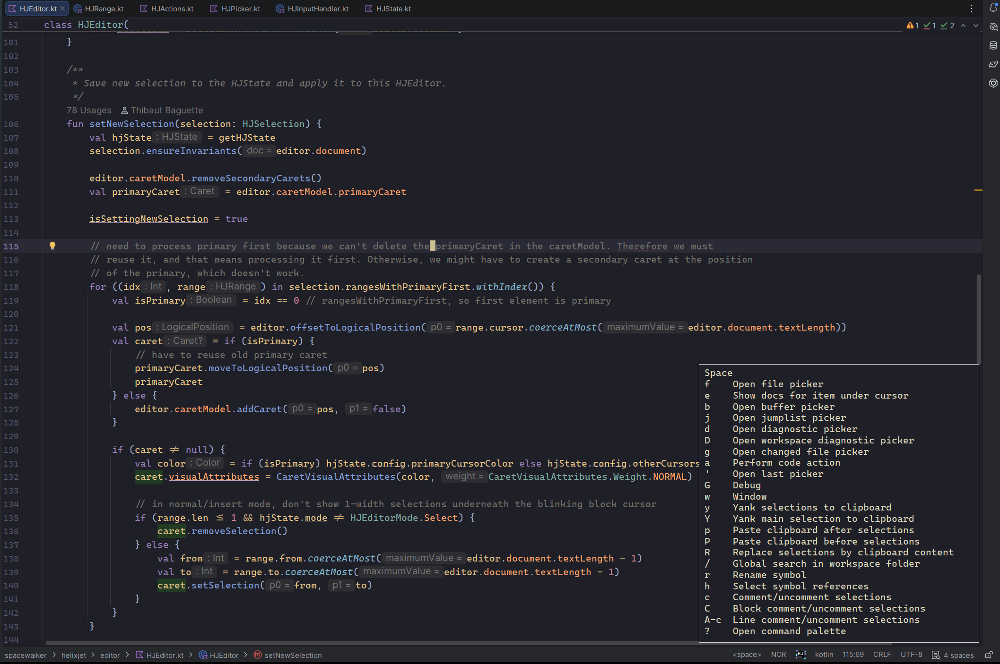
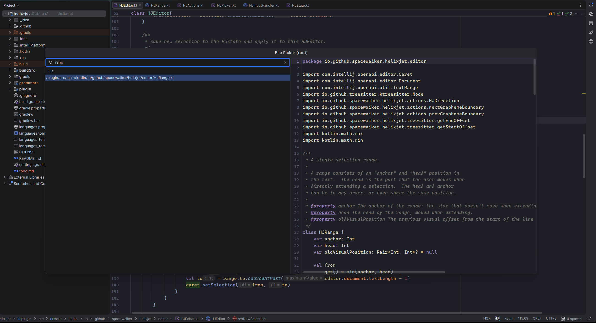
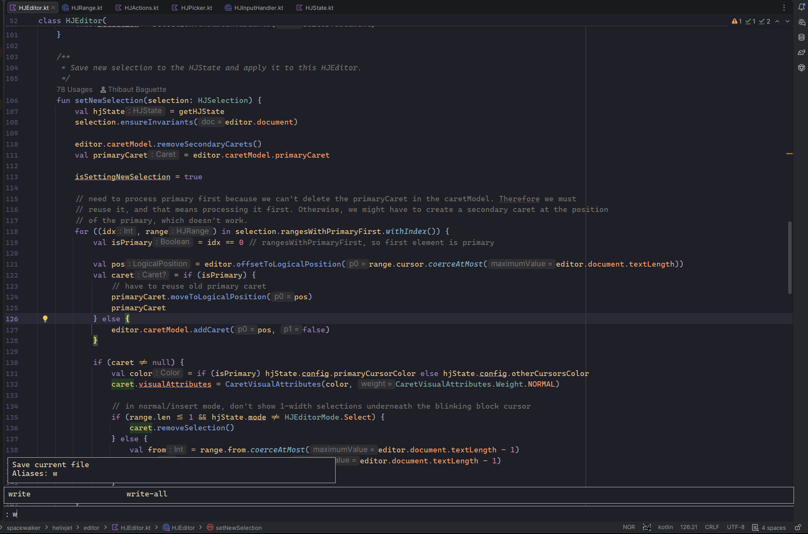

# HelixJet
Helix key mapping plugin for JetBrains IDEs.

HelixJet tries to provide an experience close to a full Helix experience within your IDE. Current features include:
- Normal/Insert/Select modes
- Command mode (with select commands)
- Bespoke UI elements such as the keybind helper (e.g. when pressing `<space>`), documentation for Command mode commands, pickers, etc.
- Full key remapping using Helix config syntax in a TOML file
- Full AST support for 23 languages (regardless of IDE)

## Configuration
HelixJet's configuration file lives in `~/.helixjet.toml`. 

The configuration schema used is identical to Helix, meaning that you can simply use your existing Helix configuration.

It supports an import syntax of the type:
```toml
# ~/.helixjet.toml
extend = "path/to/config.toml"

# override key config
[keys.insert]
"A-c" = "insert_newline"
```

As such, you can import your Helix configuration in this file, and add any overrides if necessary.

### Supported configuration fields
The list of config fields supported by HelixJet is below. Any other fields are simply ignored.
- `keys` (e.g. `keys.normal.a = "no-op"`)
  - An additional `"passthrough"` option is available, which signifies that the keybind should not be handled and instead
    be passed on to the IDE.
- `editor.scrolloff`
- `editor.continue-comments`
- `editor.search.smart-case` and `editor.search.wrap-around`
- `editor.jump-label-alphabet`
- `ignore` (HelixJet specific, see below)

#### Ignore
The `ignore` field is not something found in Helix, it is specific to HelixJet. It allows users to specify `.gitignore`-style
patterns of files that should be ignored in things such as the file picker.

**Note:** This is in addition to any `.gitignore`/`.p4ignore` already considered by the IDE.

## Language support
For features related to the AST, HelixJet relies on Tree-Sitter and Helix's scheme queries. Currently, only a subset of 
the languages are supported in this way; they are, however, supported across all IDEs. HelixJet identifies the file type
of the current file in the same way Helix does, and shows this in the status bar. If the language has an asterisk, this
indicates no AST support for that language. The current list of supported languages is:

- Bash
- C
- C#
- cmake
- C++
- GDScript
- Go
- HTML
- ini
- Java
- JavaScript
- Json
- Kotlin
- Lua
- Markdown
- PHP
- Python
- Ruby
- Rust
- SQL
- TOML
- TypeScript
- Yaml


## Screenshots
### Space menu


### File picker


### Command mode

